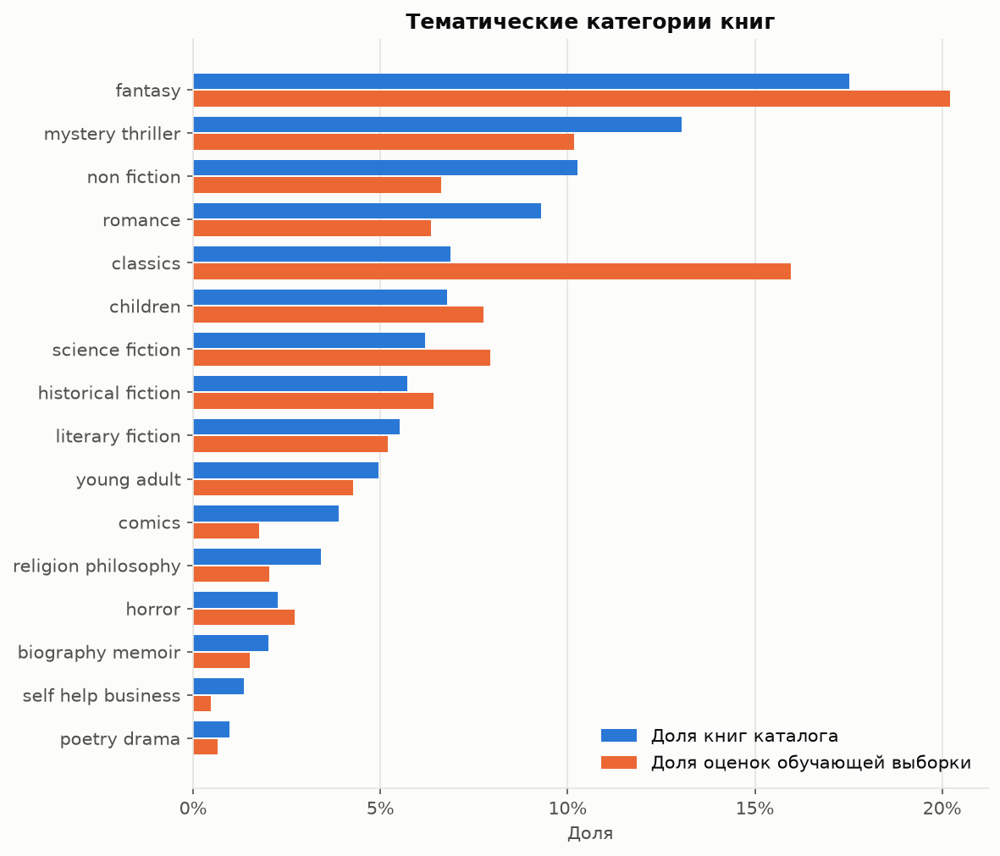
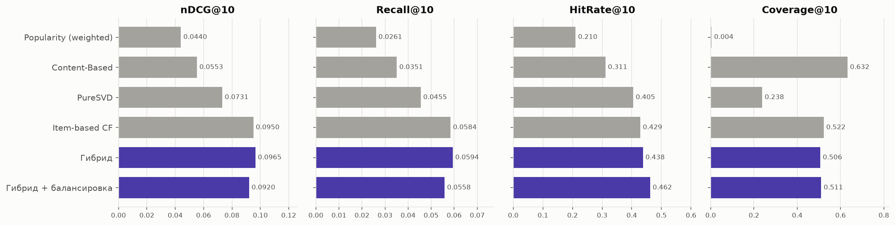
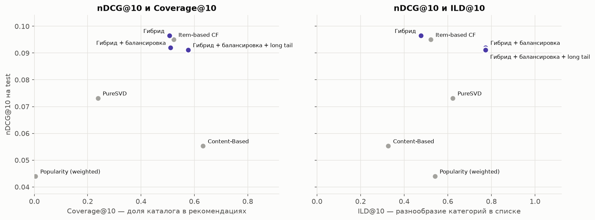
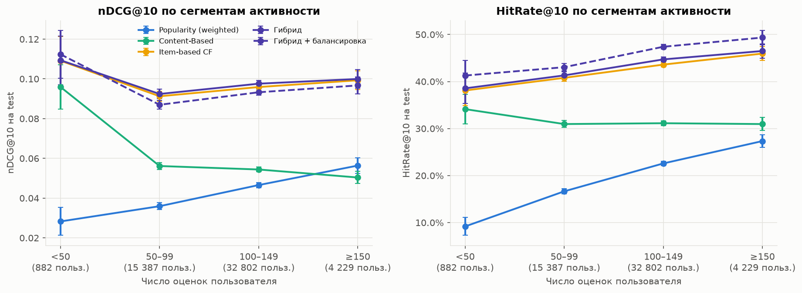
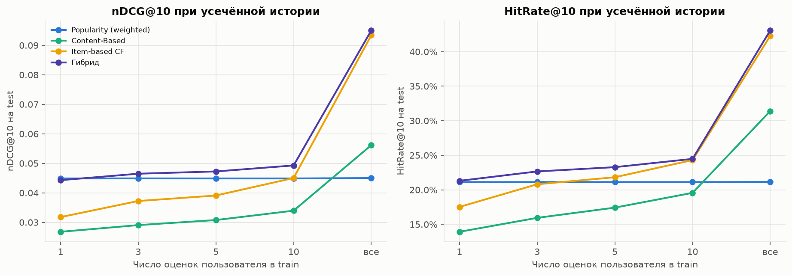

# Гибридная система рекомендаций книг (goodbooks-10k)

## Задача

Построение гибридной системы рекомендаций книг на датасете goodbooks-10k: объединение моделей Popularity, Content-Based, Item-based CF и SVD в единый пул кандидатов с весовой схемой по типам пользователей и балансировкой выдачи. Решение расширяет модели и протокол оценки домашнего задания №1 расширенными признаками, генерацией кандидатов и переранжированием.

## Данные

Источник — актуальная версия датасета [goodbooks-10k](https://github.com/zygmuntz/goodbooks-10k) на GitHub, загружаемая согласно инструкции на странице [Kaggle](https://www.kaggle.com/datasets/zygmunt/goodbooks-10k). Версия датасета на Kaggle устарела: содержит дубликаты записей и выборку около 100 оценок на книгу вместо полного объёма. Лицензия — CC BY-SA 4.0.

Используются таблицы `ratings.csv` (5 976 479 оценок, `user_id, book_id, rating`, порядок строк хронологический), `books.csv` (10 000 книг), `tags.csv` и `book_tags.csv` (теги книг, присоединяются через `goodreads_book_id`). Описаний книг и явных меток времени в датасете нет.

## Структура репозитория

```
Rec_Systems_Session_Project/
├── README.md                    # компактный отчёт
├── requirements.txt             # закреплённые версии зависимостей
├── pyproject.toml               # пакет recsys в src/, конфигурация ruff и pytest
├── .gitignore
├── scripts/
│   └── download_data.py         # загрузка CSV датасета с GitHub в data/raw
├── src/recsys/
│   ├── config.py                # пути, константы, протокол оценки
│   ├── data.py                  # загрузка, валидация, очистка тегов, матрица взаимодействий
│   ├── split.py                 # per-user temporal split train / test
│   ├── metrics.py               # Precision@K, Recall@K, nDCG@K, HitRate, Coverage, Novelty, ILD
│   ├── evaluation.py            # формирование набора оценки, сравнение моделей, сегменты
│   ├── cold_start.py            # симуляция новых пользователей: усечение истории, переобучение, оценка
│   ├── features.py              # признаки книг, пользователей и пар; тематические категории
│   ├── candidates.py            # пул кандидатов из нескольких моделей, источники кандидата
│   ├── hybrid.py                # взвешенный гибрид по типам пользователей, подбор весов и квот
│   ├── balancing.py             # переранжирование с квотами категорий и long tail
│   ├── plots.py                 # единый стиль графиков, сохранение в reports/figures
│   └── models/                  # Popularity, Content-Based, Item-based CF, FunkSVD, PureSVD
├── notebooks/
│   └── hybrid_recsys.ipynb      # выполненный ноутбук с результатами по этапам
├── reports/figures/             # графики, используемые в README
└── tests/                       # тесты метрик, split, моделей, оценки, признаков, гибрида
```

## Протокол оценки

Протокол перенесён из домашнего задания №1 без изменений, поэтому числа отдельных моделей сопоставимы с ним.

- **Split**: per-user temporal — последние 20 % оценок пользователя (по порядку строк) попадают в test, пользователи с менее чем 5 оценками целиком остаются в train. Параметры подбираются на том же разбиении train на train_inner и valid; test используется один раз, для итогового сравнения.
- **Релевантность**: книга из отложенной части с оценкой ≥ 4. Оцениваются пользователи хотя бы с одной релевантной книгой: на valid — фиксированная случайная выборка 10 000 пользователей (`RANDOM_STATE = 42`), на test — все 53 300 таких пользователей.
- **Метрики**: Precision@K, Recall@K (знаменатель — число релевантных книг), nDCG@K (бинарный gain, IDCG по min(K, |rel|)), HitRate@K, Coverage@K, Novelty@K; K ∈ {5, 10, 20}, основная точка — K = 10. Ранжируется весь каталог, книги из train пользователя исключаются.
- **Разнообразие выдачи**: число различных категорий в top-10, intra-list diversity по категориям (1 − доля пар top-10 из одной категории) и доля позиций вне head — 1 000 самых популярных книг (10 % каталога).

Перенос кода проверен: nDCG@10 четырёх моделей на valid совпадает с домашним заданием с точностью до 1e-4 (раздел «Этап 0» ноутбука).

## Решение

### Признаки

Признаки считаются только по обучающей выборке (train для итоговой оценки, train_inner для подбора весов на valid) векторно, через `np.bincount` и разреженные матрицы (`src/recsys/features.py`). Описательные таблицы и пример профиля пользователя — раздел «Этап 1» ноутбука.

| Группа | Признаки |
|---|---|
| Книга | число оценок и его логарифм; средняя оценка; Bayesian average (сглаживание к глобальному среднему, m = 50); стандартное отклонение оценок; доля оценок 1–2; тематическая категория |
| Пользователь | число оценок; средняя оценка и её стандартное отклонение; доля оценок 4–5; мейнстримность (среднее log(1 + n) по прочитанным книгам, n — число оценок книги); число категорий в истории; профиль — доли понравившихся книг по категориям; тип: new (≤ 10 оценок) или active |
| Пара «пользователь × книга» | cosine к TF-IDF-профилю пользователя (Content-Based); сумма схожестей Item-based CF с понравившимися книгами; affinity к категории книги; прогноз оценки FunkSVD |

Категория книги выбирается из 16 тематических категорий: fantasy, science fiction, mystery/thriller, romance, young adult, children, classics, literary fiction, historical fiction, horror, non-fiction, biography/memoir, self-help/business, poetry/drama, comics, religion/philosophy. Очищенные теги сопоставляются категориям по шаблонам ключевых слов, книге присваивается категория с наибольшей суммой счётчиков тегов. Категорию получают все 10 000 книг. Распределения по каталогу и по оценкам различаются: classics — 6.9 % книг и 16.0 % оценок train_inner, comics — 3.9 % и 1.8 %.



Affinity пользователя u к категории c сглаживается к доле категории в данных: a(u, c) = (l_uc + α·p_c) / (l_u + α), где l_uc — число понравившихся (оценка ≥ 4) книг категории c, l_u — всех понравившихся книг, p_c — доля категории среди понравившихся оценок, α = 10. В train_inner у каждого пользователя не меньше 12 оценок, поэтому тип new встречается только в симуляции cold start с усечённой историей.

На 2 000 пользователях valid признаки пар для релевантных книг в среднем выше, чем для случайных непрочитанных: Item-CF-скор — в 18.5 раза, content_sim — в 2.3 раза, affinity — в 2.2 раза; прогноз FunkSVD — 4.09 против 4.00.

### Гибридная система

Рекомендации формируются в три шага (`candidates.py`, `hybrid.py`, `balancing.py`; раздел «Этап 2» ноутбука).

1. **Кандидаты.** Popularity (weighted), Content-Based, Item-based CF и PureSVD дают по 50 непрочитанных книг: книги из train исключаются до выбора top-N. Списки объединяются без дубликатов с сохранением источников книги. Книги с минимальным скором источника (например, с нулевой схожестью Item-CF) в пул не попадают, поэтому для пользователя без понравившихся книг такой источник кандидатов не даёт.
2. **Взвешенный скор.** score(u, i) = Σ_m w_m(type_u) · s̃_m(u, i), где s̃_m — скор компоненты, нормированный min-max внутри пула пользователя. Компоненты: скоры Popularity, Content-Based, Item-based CF, PureSVD, прогноз оценки FunkSVD и affinity к категории книги.
3. **Типы пользователей.** Веса задаются отдельно для new (не более 10 оценок в train) и active. Если пул короче K, список дополняется книгами Popularity без прочитанного.

Пул на valid (10 000 пользователей, модели обучены на train_inner) содержит в среднем 150.6 книги:

| Источник | Recall@50 | Доля релевантных книг, найденных только этим источником |
|---|---|---|
| Popularity (weighted) | 0.090 | 9.6 % |
| Content-Based | 0.125 | 10.8 % |
| Item-based CF | 0.211 | 13.5 % |
| PureSVD | 0.164 | 15.7 % |
| Пул (Recall@pool) | **0.355** | 49.6 % (один источник) |

Recall@pool в 1.7 раза выше, чем у лучшего источника, а половину найденных релевантных книг даёт только один источник. Пул со скорами компонент для 10 000 пользователей строится за 14 с. С единственной компонентой item_cf гибрид воспроизводит Item-based CF (nDCG@10 0.0968): это контроль нормализации и ранжирования пула.

### Балансировка

Пул переранжируется жадно по убыванию скора с квотами: не более q книг одной категории и не менее t книг вне head в top-10; для других K квоты пересчитываются пропорционально. Квоты, невыполнимые для пула пользователя, ослабляются по очереди (сначала t, затем q), выбранные книги упорядочиваются по скору. Сбалансированный список строится отдельно для каждого K, а не усекается.

### Подбор весов и квот

Веса и квоты подбираются на valid по готовому пулу, без повторного скоринга моделей (раздел «Этап 3», 3.1–3.3 ноутбука). Для каждого типа пользователя перебирается сетка 0, 0.25, 0.5, 0.75, 1 по трём основным компонентам (124 сочетания), остальные компоненты сохраняют стартовые веса; критерий — nDCG@10. В valid нет пользователей с ≤ 10 оценками, поэтому веса new подбираются на симуляции: у 5 000 пользователей история train_inner усекается до 1, 3, 5 или 10 оценок, модели обучаются заново.

| Тип | Основные компоненты сетки | popularity | content | item_cf | pure_svd | funk_svd | affinity | nDCG@10 (valid): стартовые → подобранные |
|---|---|---|---|---|---|---|---|---|
| active | item_cf, pure_svd, content | 0.033 | 0 | **0.667** | 0.167 | 0.067 | 0.067 | 0.0957 → **0.0972** (Item-based CF 0.0968) |
| new | popularity, content, item_cf | **0.571** | 0 | 0.286 | 0.029 | 0.029 | 0.086 | 0.0414 → **0.0451** (Popularity 0.0435) |

Веса нормированы к сумме 1. У активных пользователей основной сигнал даёт Item-based CF, PureSVD добавляет 0.0011 к nDCG@10; у новых — Popularity с весом Item-based CF вдвое меньше. Content-Based в лучших сочетаниях обоих типов не участвует.

Квоты перебираются по q ∈ {3, 4, 5} и t ∈ {0, 3}. Правило выбора задано до перебора: наибольший ILD среди вариантов, снижающих nDCG@10 не более чем на 5 % относительно выдачи без квот.

| Квоты (valid, K = 10) | nDCG@10 | HitRate@10 | Категорий в top-10 | ILD | Доля вне head |
|---|---|---|---|---|---|
| без квот | 0.0972 | 0.432 | 2.99 | 0.477 | 0.271 |
| q = 3 | 0.0890 (−8.4 %) | 0.456 | 4.91 | 0.840 | 0.202 |
| **q = 4** (выбрано) | 0.0925 (−4.9 %) | 0.455 | 4.28 | 0.773 | 0.222 |
| q = 5 | 0.0945 (−2.7 %) | 0.451 | 3.84 | 0.709 | 0.236 |
| q = 4, t = 3 | 0.0910 (−6.4 %) | 0.448 | 4.24 | 0.772 | 0.352 |

Квота t = 3 добавляет 1.4–1.8 % потери nDCG@10 и в допустимую область с q = 4 не попадает; на test она оценивается как отдельный вариант.

## Основные результаты

Модели обучены на всём train, оцениваются все 53 300 пользователей test с хотя бы одной релевантной книгой (раздел 3.4 ноутбука). Числа отдельных моделей совпадают с домашним заданием.

| Модель (test) | nDCG@5 | nDCG@10 | nDCG@20 | Precision@10 | Recall@10 | HitRate@10 |
|---|---|---|---|---|---|---|
| Popularity (weighted) | 0.0495 | 0.0440 | 0.0435 | 0.0395 | 0.0261 | 0.210 |
| Content-Based | 0.0590 | 0.0553 | 0.0580 | 0.0504 | 0.0351 | 0.311 |
| PureSVD | 0.0784 | 0.0731 | 0.0765 | 0.0670 | 0.0455 | 0.405 |
| FunkSVD | 0.0027 | 0.0032 | 0.0041 | 0.0034 | 0.0023 | 0.027 |
| Item-based CF | 0.1032 | 0.0950 | 0.0976 | 0.0858 | 0.0584 | 0.429 |
| **Гибрид** | **0.1045** | **0.0965** | **0.0991** | **0.0872** | **0.0594** | 0.438 |
| Гибрид + балансировка (q = 4) | 0.0979 | 0.0920 | 0.0961 | 0.0809 | 0.0558 | **0.462** |
| Гибрид + балансировка + long tail (q = 4, t = 3) | 0.0959 | 0.0912 | 0.0953 | 0.0795 | 0.0551 | 0.459 |
| Гибрид без affinity | 0.1049 | 0.0966 | 0.0995 | 0.0873 | 0.0595 | 0.439 |

| Модель (test, K = 10) | Coverage@10 | Novelty@10 | Категорий в top-10 | ILD | Доля вне head |
|---|---|---|---|---|---|
| Popularity (weighted) | 0.004 | 8.55 | 3.77 | 0.541 | 0.000 |
| Content-Based | **0.632** | 12.16 | 2.27 | 0.327 | **0.475** |
| PureSVD | 0.238 | 11.15 | 3.86 | 0.623 | 0.165 |
| Item-based CF | 0.522 | 10.96 | 3.32 | 0.522 | 0.296 |
| Гибрид | 0.506 | 11.04 | 3.01 | 0.476 | 0.288 |
| Гибрид + балансировка (q = 4) | 0.511 | 10.80 | **4.29** | **0.774** | 0.235 |
| Гибрид + балансировка + long tail | 0.576 | 11.22 | 4.25 | 0.772 | 0.361 |
| Гибрид без affinity | 0.500 | 10.99 | 3.31 | 0.524 | 0.281 |



Гибрид превосходит лучшую отдельную модель при всех K: nDCG@10 выше на 1.6 % (0.0965 против 0.0950), nDCG@5 и nDCG@20 — на 1.3 % и 1.5 %. Балансировка с q = 4 снижает nDCG@10 на 4.7 % (на valid ожидалось −4.9 %), но повышает HitRate@10 на 5.6 % и ILD с 0.476 до 0.774. Квота long tail поднимает Coverage@10 до 0.576 и долю книг вне head до 0.361 ценой ещё 0.0008 nDCG@10.



**Вклад признаков.** Без компоненты affinity точность не снижается (nDCG@10 0.0966 против 0.0965), а ILD растёт с 0.476 до 0.524: affinity дублирует сигнал о любимых категориях, который уже содержат Item-based CF и PureSVD. Признаки пар используются в гибриде как компоненты скора; категория книги работает в балансировке, где квота q = 4 даёт +63 % ILD.

**Сегменты активности.** Гибрид не уступает Item-based CF ни в одном сегменте по числу оценок, но разница (например, nDCG@10 0.0976 против 0.0959 у пользователей со 100–149 оценками) меньше 95 % доверительных интервалов. Балансировка повышает HitRate@10 во всех сегментах на 1.8–2.9 п. п. (раздел 3.5).



**Новые пользователи.** У 5 000 пользователей test история усекается до 1–10 оценок, модели обучаются заново (раздел 3.6). Гибрид с весами new превосходит Item-based CF и Content-Based при любой длине истории, а Popularity — начиная с трёх оценок (nDCG@10 0.0465 против 0.0449; при 10 оценках 0.0493 против 0.0449). При одной оценке гибрид и Popularity практически равны (0.0443 против 0.0449), а Item-based CF выходит на уровень Popularity только к 10 оценкам. Coverage@10 гибрида (0.23–0.28) в 67–79 раз выше, чем у Popularity.



## Выводы

| Модель | Сильные стороны | Слабые стороны |
|---|---|---|
| Popularity (weighted) | лучший вариант при одной оценке в истории (nDCG@10 0.0449); не требует истории | Coverage@10 0.004, нет книг вне head; nDCG@10 в 2.2 раза ниже, чем у Item-based CF |
| Content-Based | наибольшие Coverage@10 (0.632) и доля long tail (0.475); близка к Item-based CF у пользователей с < 50 оценками (0.0959 против 0.1091) | самые однородные списки (2.27 категории, ILD 0.327); при короткой истории уступает Popularity |
| Item-based CF | лучшая отдельная модель (nDCG@10 0.0950, HitRate@10 0.429); объяснима через прочитанные книги | при истории до 10 оценок уступает Popularity или равна ей; ILD 0.522 |
| PureSVD | разнообразные списки (ILD 0.623) и 15.7 % уникальных находок в пуле | nDCG@10 на 23 % ниже Item-based CF, Coverage@10 0.238 |
| Гибрид | лучшая точность при всех K (nDCG@10 0.0965) и лучшая модель для истории от 3 оценок; квоты регулируют разнообразие без переобучения | выигрыш у активных пользователей 1.6 % и в пределах доверительных интервалов сегментов; у новых пользователей Coverage@10 в 2–2.8 раза ниже, чем у Item-based CF |

- Для активных пользователей (> 10 оценок) рекомендуется гибрид с весами active. Если важнее разнообразие выдачи, чем точность, подходит квота q = 4: −4.7 % nDCG@10 при +63 % ILD и +5.6 % HitRate@10; квота t = 3 добавляется, когда нужен long tail (Coverage@10 0.576).
- Для новых пользователей с 3–10 оценками рекомендуется гибрид с весами new (57 % веса — Popularity, 29 % — Item-based CF): он лучше всех отдельных моделей. При одной оценке Popularity и гибрид равноценны.
- FunkSVD как самостоятельная top-N модель непригоден (nDCG@10 0.0032): прогноз оценки поднимает малоизвестные книги, поэтому он используется только как компонента с малым весом.
- Компонента affinity в текущем виде не повышает точность и сужает выдачу: её вес следует подбирать вместе с основными компонентами или исключить.
- Recall@pool 0.355 ограничивает полноту гибрида сверху: 64.5 % релевантных книг valid в пул не попадают, поэтому следующий резерв качества — генерация кандидатов, а не веса.

## Пути развития

- Ранжирование пула обучаемой моделью (learning-to-rank, например LambdaMART) на признаках этапа 1 вместо линейной смеси с весами по сетке.
- Расширение пула: больше кандидатов от Item-based CF и PureSVD, кандидаты по эмбеддингам названий и тегов книг.
- Учёт порядка чтения: последовательные модели по истории оценок (порядок строк в `ratings.csv` хронологический).
- Совместный подбор весов всех компонент, включая affinity, и квот с учётом ILD как второго критерия.

### Направление развития: нейросетевой компонент

Нейросетевую модель предлагается встроить в существующий пул без изменения протокола оценки. Основной вариант — Two-Tower. Башня пользователя получает эмбеддинг идентификатора и признаки этапа 1: число оценок, среднюю оценку, мейнстримность, профиль по категориям. Башня книги получает эмбеддинг идентификатора, категорию и признаки книги (популярность, Bayesian average, долю низких оценок). Скор пары — скалярное произведение векторов uᵀv; обучение — на оценках ≥ 4 train с негативами из непрочитанных книг. Обученная модель встраивается в гибрид двумя способами: как пятый источник кандидатов (top-50 по uᵀv через поиск ближайших соседей) и как дополнительная компонента взвешенного скора, вес которой подбирается на valid той же сеткой. Башни на признаках дают векторы и пользователям с короткой историей, поэтому компонента может получить вес и у типа new.

Альтернатива — Wide & Deep-ранжировщик пула: wide-часть принимает скоры моделей-компонент и флаги источников, deep-часть — эмбеддинги пользователя, книги и категории. Такой ранжировщик заменяет линейную смесь, а балансировка квотами остаётся последним шагом. Оценка обоих вариантов — по тем же full-catalog метрикам на test, по сегментам активности и на симуляции новых пользователей, для прямого сравнения с таблицами этого отчёта.

## Воспроизведение

Требования: Python 3.14 (Windows, x86-64); проверено на Python 3.14.3.

```bash
git clone https://github.com/a-kapset/Rec_Systems_Session_Project.git
cd Rec_Systems_Session_Project
python -m venv .venv
.venv\Scripts\activate            # Linux/macOS: source .venv/bin/activate
pip install -r requirements.txt
pip install -e .
python -m ipykernel install --sys-prefix --name python3 --display-name "Python 3 (recsys)"
```

Получение данных (файлы сохраняются в `data/raw/`):

- автоматически: `python scripts/download_data.py` — загрузка `ratings.csv`, `books.csv`, `tags.csv`, `book_tags.csv` из репозитория https://github.com/zygmuntz/goodbooks-10k с проверкой числа строк; уже загруженные файлы пропускаются;
- вручную: скачать те же четыре файла из репозитория https://github.com/zygmuntz/goodbooks-10k и поместить в каталог `data/raw/`.

Тесты и выполнение ноутбука (в активированном окружении):

```bash
pytest
jupyter nbconvert --to notebook --execute --inplace notebooks/hybrid_recsys.ipynb
```
